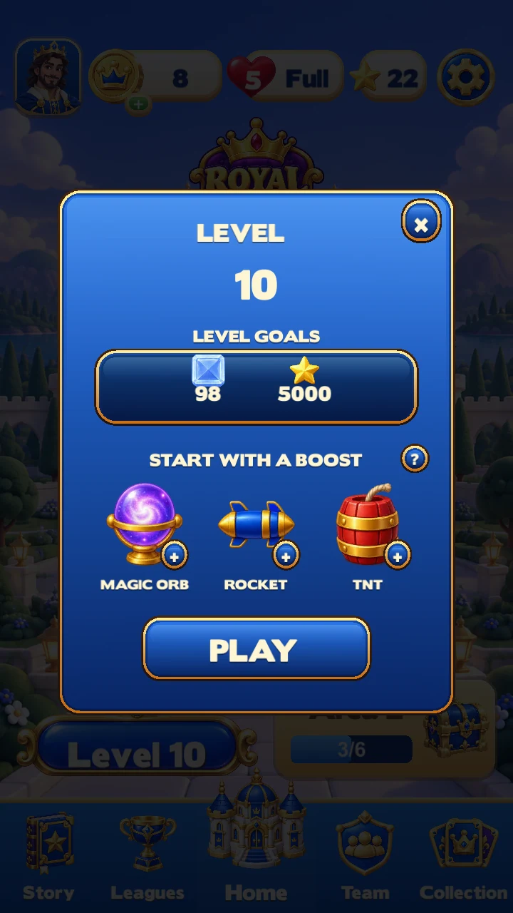
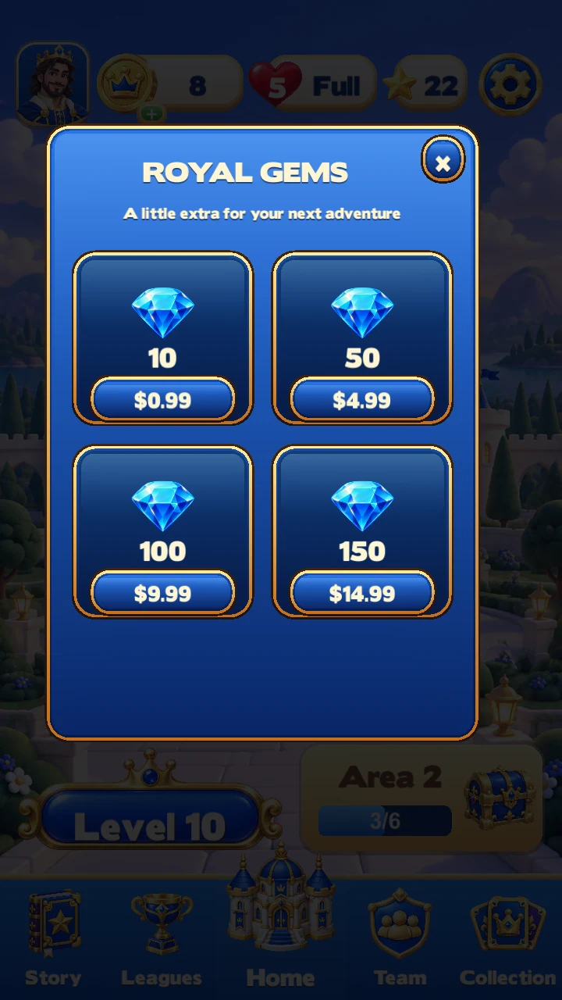
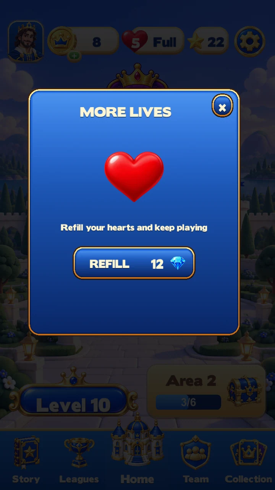
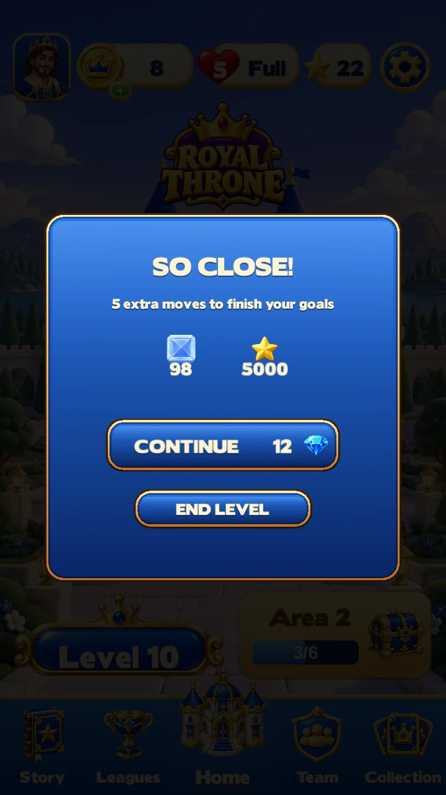

# Royal Throne — gameplay polish review

This is the playable Unity version, with the existing castle music preserved. Effects use native Unity Particle Systems, pooled projectiles and short material fragments. The sound pass adds ceramic contacts, a compact TNT impact, rocket ignition and rotor flutter.

[Watch the Unity effects and audio capture](royal-throne-unity-effects.mp4). The controlled board resets between test cases. About ten distinct frames per second are captured; live Play Mode shows the full animation.

## Updated screens

Settings, booster help, all five tutorial pages and the result layouts are captured alongside these screens. Result previews do not represent earned wins or tested purchases.

The next designer review should focus on blast clarity, tile readability during cascades, impact weight and sound fatigue over normal levels. This pass does not establish parity with or superiority over Royal Match.

See [validation](../VALIDATION.md) for the checks and their limits, and [the editor workflow](../README.md) for tuning the effects directly in Unity.
