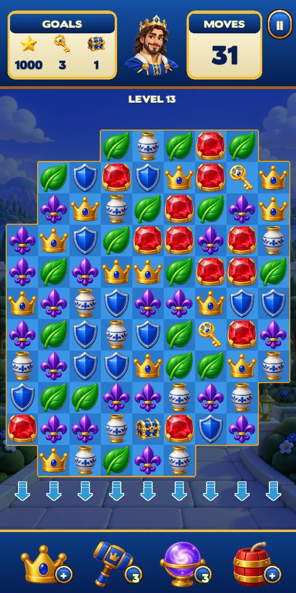
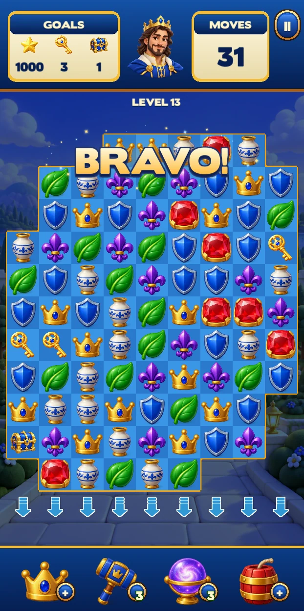
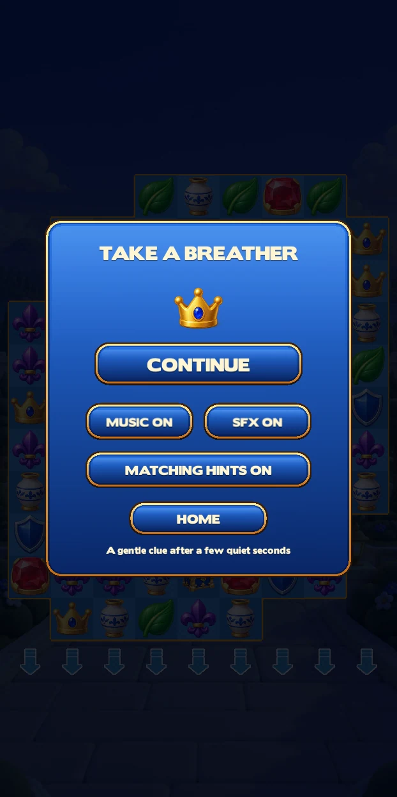
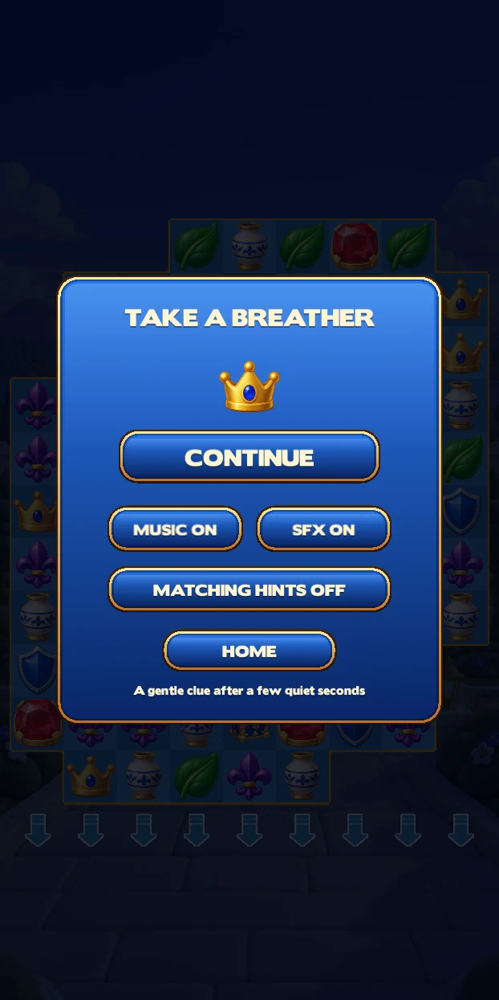
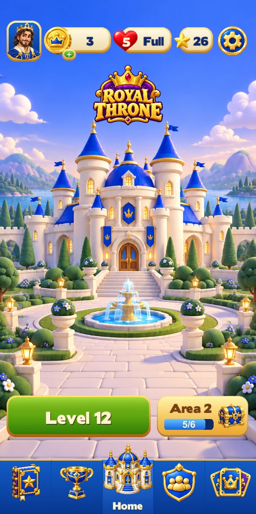
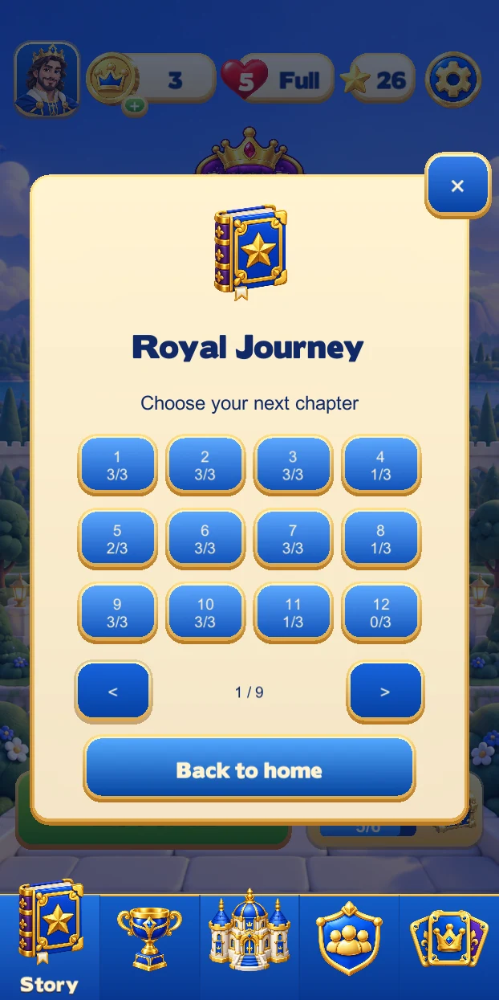
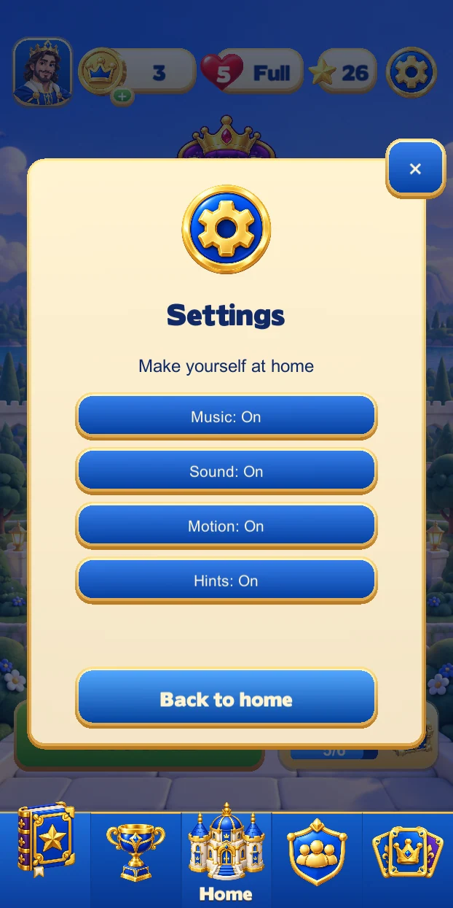

# Royal Throne Unity review v3

Captured in the independent project on 14 September 2026 at **622 × 1245**. These are actual Unity Play Mode screens, converted to WebP without changing their content or dimensions.

[Watch the gameplay and effects video](royal-throne-unity-effects.mp4) (**38.4 seconds**) or [view the 12-frame contact sheet](effects-contact-sheet.webp). [Captured audio measurements](captured-audio-checks.json) report a peak of **?8.66 dBFS** and **zero clipped samples**. The [video capture manifest](capture-manifest.json) records the source frames, encoding dimensions and successful full decode check.

- [Home checks](home-checks.txt): **167 PASS**, including saved resources, next-level entry, original life timer, selected tab labels, generous navigation hit targets, raised-icon clearance, direct tab switching, Hints preference changes/restoration, and return from the existing pre-level menu. The report records no runtime errors or consumed coins/lives.
- [Dialog checks](dialog-checks.txt): **21 PASS** across menu headings, target counts, tutorial layouts and dismissal paths. The review preserved gems and lives and invoked no purchase callbacks.
- [Gameplay checks](gameplay-checks.txt): **264 completed, zero runtime errors**. Covers matches, powers and combinations, falling fragments, celebrations, hints, pooling, gravity/refill and input recovery. The disposable fixture preserves the player's economy.
- Input checks in that report route virtual mouse/touch events through production input, collider hit tests and `Item.Update`: invalid drag returns both pieces without spending a move; horizontal, vertical touch and visible-edge drags match and spend exactly one move; locked/off-board input is ignored; release leaves no stuck pointer. Caller moves, score, move ID and input state are restored.
- **16 board-fit cases** cover four board shapes at 360 × 640, 390 × 844, 412 × 915 and 768 × 1024, including safe-area and booster clearance. These are layout calculations exercised by the regression helper, not 16 physical-device playtests.

In the actual pause menu, **Hints On ? Off ? On** was manually verified during this run. Splash ? loading ? home was also visually inspected.

| Gameplay | Celebration |
| --- | --- |
|  |  |

| Hints on | Hints off |
| --- | --- |
|  |  |

The gameplay, final Bravo celebration and pause images are completed Game-view frames captured after rendering. [Gameplay still provenance](gameplay-still-manifest.json) records their source times, unchanged dimensions and WebP sizes. The [runtime hierarchy](hierarchy.txt) records the pause-state inspection. The Bravo still includes the final expanded sparkle spread; this decorative adjustment was made after the video capture.

| Home and settings | Navigation and level entry |
| --- | --- |
|  |  |
|  |  |

[Home capture provenance](home-capture-manifest.json) records the source paths, capture times, dimensions and compact file sizes for the home gallery.

These editor checks do not establish physical-phone performance or player retention.
