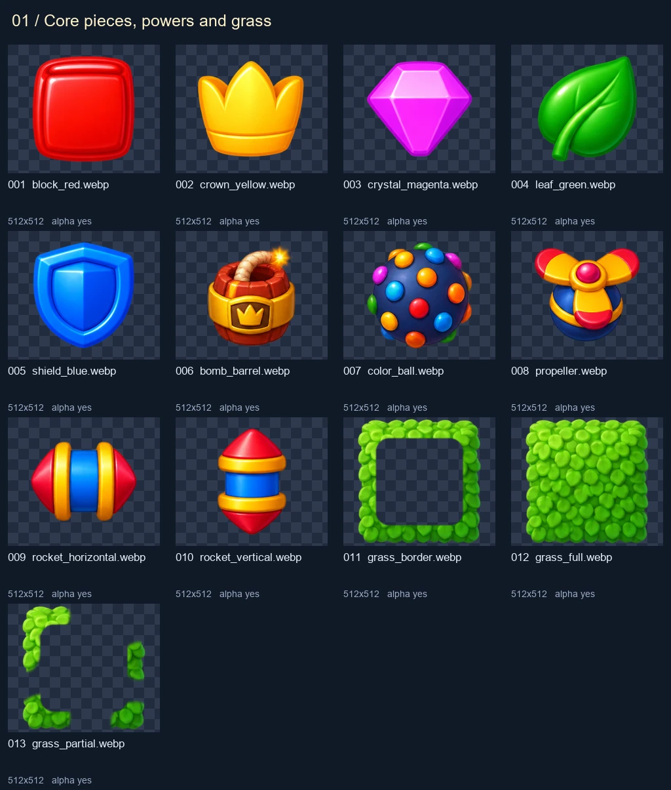
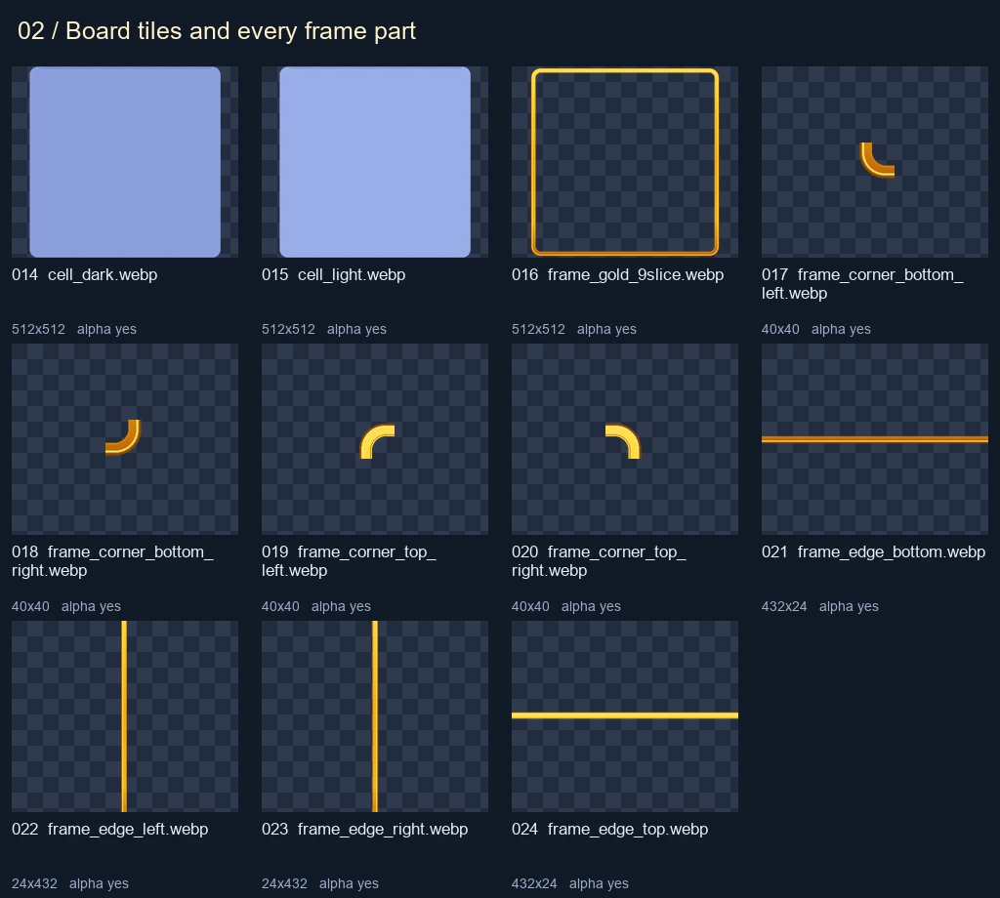
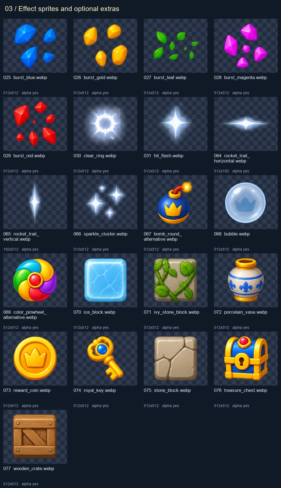
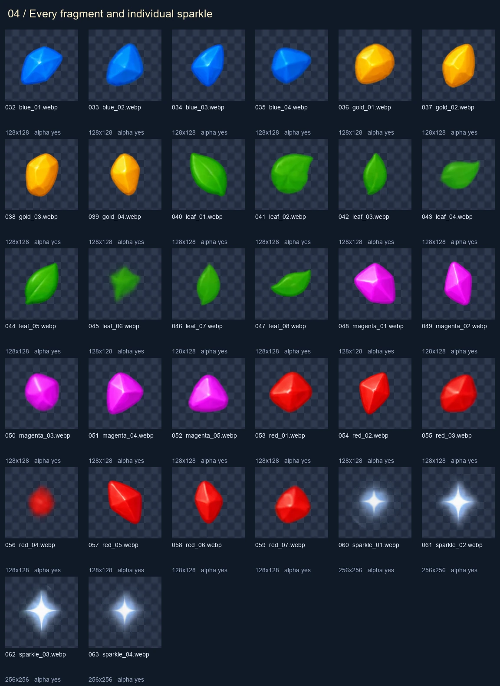
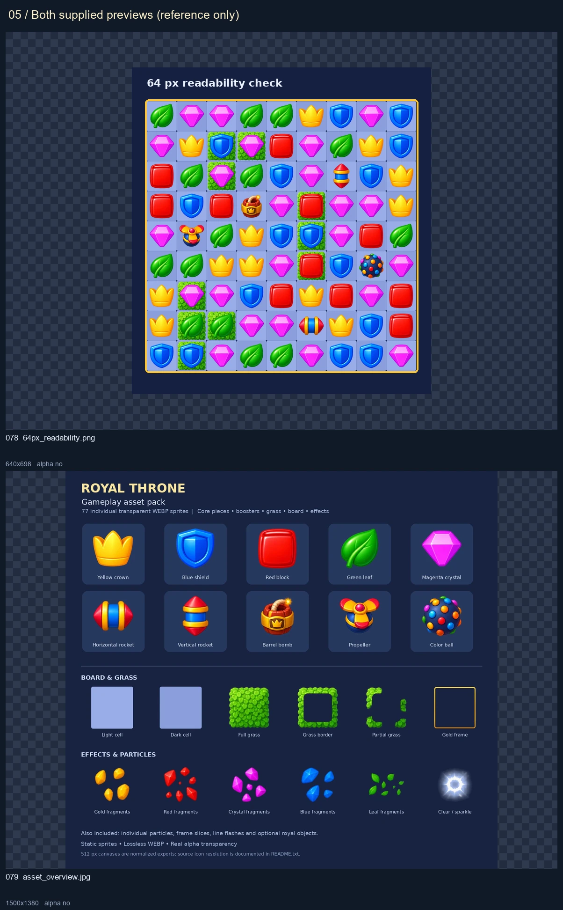

# Royal Throne gameplay asset audit

Source (read only): `J:\Unity Projects\Match3-Games_ArtSource\Match-3-JC\Royal_Throne_Gameplay_Assets`

81 files; 79 bitmaps; 4,515,299 bytes. Types: {'.webp': 77, '.json': 1, '.png': 1, '.jpg': 1, '.txt': 1}. All bitmaps appear exactly once across the five numbered sheets.

README and manifest were read as pack data. Their suggestions are not instructions to change the game.

Prefabs: none. Materials: none. Other Unity/model assets: none.

Manifest discrepancies: 0. Source-resolution statements are copied metadata; the generated 512px exports are not evidence of native 512px source detail.

## Contact sheets

### 01 / Core pieces, powers and grass

### 02 / Board tiles and every frame part

### 03 / Effect sprites and optional extras

### 04 / Every fragment and individual sparkle

### 05 / Both supplied previews (reference only)

## Subfolders

- 01_match_pieces
- 02_powerups
- 03_grass
- 04_board
- 04_board/frame_parts
- 05_effects
- 05_effects/bursts
- 05_effects/particles
- 06_optional_extras
- previews

## Measured bitmap inventory

Bounds use [left, top, right, bottom), with alpha > 0. JPEG/opaque previews have full-image bounds.

| ID | File | Size | Alpha | Visible bounds | Visible extent | Bytes |
| --- | --- | --- | --- | --- | --- | --- |
| 001 | 01_match_pieces/block_red.webp | 512x512 | True | [45, 41, 466, 471] | [0.8223, 0.8398] | 88,462 |
| 002 | 01_match_pieces/crown_yellow.webp | 512x512 | True | [41, 61, 471, 451] | [0.8398, 0.7617] | 86,208 |
| 003 | 01_match_pieces/crystal_magenta.webp | 512x512 | True | [41, 62, 471, 450] | [0.8398, 0.7578] | 71,046 |
| 004 | 01_match_pieces/leaf_green.webp | 512x512 | True | [53, 41, 458, 471] | [0.791, 0.8398] | 94,504 |
| 005 | 01_match_pieces/shield_blue.webp | 512x512 | True | [50, 41, 461, 471] | [0.8027, 0.8398] | 87,652 |
| 006 | 02_powerups/bomb_barrel.webp | 512x512 | True | [76, 41, 436, 471] | [0.7031, 0.8398] | 133,172 |
| 007 | 02_powerups/color_ball.webp | 512x512 | True | [42, 41, 470, 471] | [0.8359, 0.8398] | 135,260 |
| 008 | 02_powerups/propeller.webp | 512x512 | True | [41, 63, 471, 449] | [0.8398, 0.7539] | 116,228 |
| 009 | 02_powerups/rocket_horizontal.webp | 512x512 | True | [41, 94, 471, 417] | [0.8398, 0.6309] | 80,928 |
| 010 | 02_powerups/rocket_vertical.webp | 512x512 | True | [116, 41, 396, 471] | [0.5469, 0.8398] | 74,250 |
| 011 | 03_grass/grass_border.webp | 512x512 | True | [7, 3, 505, 509] | [0.9727, 0.9883] | 129,838 |
| 012 | 03_grass/grass_full.webp | 512x512 | True | [7, 3, 505, 509] | [0.9727, 0.9883] | 194,542 |
| 013 | 03_grass/grass_partial.webp | 512x512 | True | [7, 3, 505, 509] | [0.9727, 0.9883] | 85,328 |
| 014 | 04_board/cell_dark.webp | 512x512 | True | [0, 0, 512, 512] | [1.0, 1.0] | 1,366 |
| 015 | 04_board/cell_light.webp | 512x512 | True | [0, 0, 512, 512] | [1.0, 1.0] | 1,382 |
| 016 | 04_board/frame_gold_9slice.webp | 512x512 | True | [1, 1, 511, 511] | [0.9961, 0.9961] | 13,246 |
| 017 | 04_board/frame_parts/frame_corner_bottom_left.webp | 40x40 | True | [1, 0, 40, 39] | [0.975, 0.975] | 1,632 |
| 018 | 04_board/frame_parts/frame_corner_bottom_right.webp | 40x40 | True | [0, 0, 39, 39] | [0.975, 0.975] | 1,730 |
| 019 | 04_board/frame_parts/frame_corner_top_left.webp | 40x40 | True | [1, 1, 40, 40] | [0.975, 0.975] | 1,478 |
| 020 | 04_board/frame_parts/frame_corner_top_right.webp | 40x40 | True | [0, 1, 39, 40] | [0.975, 0.975] | 1,522 |
| 021 | 04_board/frame_parts/frame_edge_bottom.webp | 432x24 | True | [0, 5, 432, 23] | [1.0, 0.75] | 178 |
| 022 | 04_board/frame_parts/frame_edge_left.webp | 24x432 | True | [1, 0, 20, 432] | [0.7917, 1.0] | 960 |
| 023 | 04_board/frame_parts/frame_edge_right.webp | 24x432 | True | [5, 0, 23, 432] | [0.75, 1.0] | 1,344 |
| 024 | 04_board/frame_parts/frame_edge_top.webp | 432x24 | True | [0, 1, 432, 20] | [1.0, 0.7917] | 158 |
| 025 | 05_effects/bursts/burst_blue.webp | 512x512 | True | [49, 41, 462, 471] | [0.8066, 0.8398] | 74,244 |
| 026 | 05_effects/bursts/burst_gold.webp | 512x512 | True | [41, 49, 471, 462] | [0.8398, 0.8066] | 73,430 |
| 027 | 05_effects/bursts/burst_leaf.webp | 512x512 | True | [41, 116, 471, 395] | [0.8398, 0.5449] | 60,936 |
| 028 | 05_effects/bursts/burst_magenta.webp | 512x512 | True | [44, 41, 467, 471] | [0.8262, 0.8398] | 80,174 |
| 029 | 05_effects/bursts/burst_red.webp | 512x512 | True | [49, 41, 462, 471] | [0.8066, 0.8398] | 88,734 |
| 030 | 05_effects/clear_ring.webp | 512x512 | True | [41, 43, 471, 469] | [0.8398, 0.832] | 145,438 |
| 031 | 05_effects/hit_flash.webp | 512x512 | True | [63, 41, 448, 471] | [0.752, 0.8398] | 103,532 |
| 032 | 05_effects/particles/blue_01.webp | 128x128 | True | [12, 17, 116, 111] | [0.8125, 0.7344] | 9,488 |
| 033 | 05_effects/particles/blue_02.webp | 128x128 | True | [16, 12, 112, 116] | [0.75, 0.8125] | 9,546 |
| 034 | 05_effects/particles/blue_03.webp | 128x128 | True | [23, 12, 104, 116] | [0.6328, 0.8125] | 8,494 |
| 035 | 05_effects/particles/blue_04.webp | 128x128 | True | [12, 18, 116, 110] | [0.8125, 0.7188] | 8,538 |
| 036 | 05_effects/particles/gold_01.webp | 128x128 | True | [13, 12, 114, 116] | [0.7891, 0.8125] | 10,612 |
| 037 | 05_effects/particles/gold_02.webp | 128x128 | True | [23, 12, 105, 116] | [0.6406, 0.8125] | 9,126 |
| 038 | 05_effects/particles/gold_03.webp | 128x128 | True | [22, 12, 106, 116] | [0.6562, 0.8125] | 9,038 |
| 039 | 05_effects/particles/gold_04.webp | 128x128 | True | [26, 12, 102, 116] | [0.5938, 0.8125] | 8,308 |
| 040 | 05_effects/particles/leaf_01.webp | 128x128 | True | [18, 12, 110, 116] | [0.7188, 0.8125] | 9,804 |
| 041 | 05_effects/particles/leaf_02.webp | 128x128 | True | [12, 14, 116, 113] | [0.8125, 0.7734] | 10,494 |
| 042 | 05_effects/particles/leaf_03.webp | 128x128 | True | [32, 12, 95, 116] | [0.4922, 0.8125] | 6,906 |
| 043 | 05_effects/particles/leaf_04.webp | 128x128 | True | [12, 24, 116, 103] | [0.8125, 0.6172] | 9,092 |
| 044 | 05_effects/particles/leaf_05.webp | 128x128 | True | [22, 12, 106, 116] | [0.6562, 0.8125] | 9,270 |
| 045 | 05_effects/particles/leaf_06.webp | 128x128 | True | [17, 12, 111, 116] | [0.7344, 0.8125] | 9,424 |
| 046 | 05_effects/particles/leaf_07.webp | 128x128 | True | [33, 12, 94, 116] | [0.4766, 0.8125] | 6,900 |
| 047 | 05_effects/particles/leaf_08.webp | 128x128 | True | [12, 29, 116, 98] | [0.8125, 0.5391] | 6,862 |
| 048 | 05_effects/particles/magenta_01.webp | 128x128 | True | [12, 12, 115, 116] | [0.8047, 0.8125] | 10,378 |
| 049 | 05_effects/particles/magenta_02.webp | 128x128 | True | [29, 12, 99, 116] | [0.5469, 0.8125] | 8,492 |
| 050 | 05_effects/particles/magenta_03.webp | 128x128 | True | [18, 12, 109, 116] | [0.7109, 0.8125] | 9,350 |
| 051 | 05_effects/particles/magenta_04.webp | 128x128 | True | [17, 12, 111, 116] | [0.7344, 0.8125] | 9,934 |
| 052 | 05_effects/particles/magenta_05.webp | 128x128 | True | [12, 16, 116, 112] | [0.8125, 0.75] | 9,688 |
| 053 | 05_effects/particles/red_01.webp | 128x128 | True | [12, 12, 116, 116] | [0.8125, 0.8125] | 10,344 |
| 054 | 05_effects/particles/red_02.webp | 128x128 | True | [25, 12, 103, 116] | [0.6094, 0.8125] | 8,802 |
| 055 | 05_effects/particles/red_03.webp | 128x128 | True | [12, 14, 116, 113] | [0.8125, 0.7734] | 9,506 |
| 056 | 05_effects/particles/red_04.webp | 128x128 | True | [20, 12, 107, 116] | [0.6797, 0.8125] | 7,712 |
| 057 | 05_effects/particles/red_05.webp | 128x128 | True | [21, 12, 107, 116] | [0.6719, 0.8125] | 9,264 |
| 058 | 05_effects/particles/red_06.webp | 128x128 | True | [25, 12, 103, 116] | [0.6094, 0.8125] | 8,156 |
| 059 | 05_effects/particles/red_07.webp | 128x128 | True | [12, 13, 116, 114] | [0.8125, 0.7891] | 9,788 |
| 060 | 05_effects/particles/sparkle_01.webp | 256x256 | True | [27, 26, 228, 230] | [0.7852, 0.7969] | 30,746 |
| 061 | 05_effects/particles/sparkle_02.webp | 256x256 | True | [34, 26, 222, 230] | [0.7344, 0.7969] | 32,154 |
| 062 | 05_effects/particles/sparkle_03.webp | 256x256 | True | [36, 26, 219, 230] | [0.7148, 0.7969] | 34,818 |
| 063 | 05_effects/particles/sparkle_04.webp | 256x256 | True | [34, 26, 221, 230] | [0.7305, 0.7969] | 32,232 |
| 064 | 05_effects/rocket_trail_horizontal.webp | 512x192 | True | [16, 24, 496, 168] | [0.9375, 0.75] | 54,068 |
| 065 | 05_effects/rocket_trail_vertical.webp | 192x512 | True | [24, 16, 168, 496] | [0.75, 0.9375] | 54,486 |
| 066 | 05_effects/sparkle_cluster.webp | 512x512 | True | [41, 61, 471, 450] | [0.8398, 0.7598] | 129,794 |
| 067 | 06_optional_extras/bomb_round_alternative.webp | 512x512 | True | [78, 41, 433, 471] | [0.6934, 0.8398] | 115,456 |
| 068 | 06_optional_extras/bubble.webp | 512x512 | True | [47, 41, 465, 471] | [0.8164, 0.8398] | 121,732 |
| 069 | 06_optional_extras/color_pinwheel_alternative.webp | 512x512 | True | [41, 47, 471, 465] | [0.8398, 0.8164] | 126,410 |
| 070 | 06_optional_extras/ice_block.webp | 512x512 | True | [49, 41, 463, 471] | [0.8086, 0.8398] | 105,472 |
| 071 | 06_optional_extras/ivy_stone_block.webp | 512x512 | True | [41, 41, 471, 471] | [0.8398, 0.8398] | 144,798 |
| 072 | 06_optional_extras/porcelain_vase.webp | 512x512 | True | [78, 41, 434, 471] | [0.6953, 0.8398] | 119,272 |
| 073 | 06_optional_extras/reward_coin.webp | 512x512 | True | [45, 41, 467, 471] | [0.8242, 0.8398] | 105,462 |
| 074 | 06_optional_extras/royal_key.webp | 512x512 | True | [79, 41, 432, 471] | [0.6895, 0.8398] | 94,290 |
| 075 | 06_optional_extras/stone_block.webp | 512x512 | True | [42, 41, 470, 471] | [0.8359, 0.8398] | 116,126 |
| 076 | 06_optional_extras/treasure_chest.webp | 512x512 | True | [41, 42, 471, 470] | [0.8398, 0.8359] | 146,564 |
| 077 | 06_optional_extras/wooden_crate.webp | 512x512 | True | [42, 41, 470, 471] | [0.8359, 0.8398] | 114,372 |
| 078 | previews/64px_readability.png | 640x698 | False | [0, 0, 640, 698] | [1.0, 1.0] | 281,633 |
| 079 | previews/asset_overview.jpg | 1500x1380 | False | [0, 0, 1500, 1380] | [1.0, 1.0] | 221,442 |

## Non-bitmap files

- `manifest.json`: 49,340 bytes, SHA256 `cad55fcdb682476ae94ee348f8fe42c7041b570f2d4e13e3468a130cbbfed9f7`
- `README.txt`: 2,414 bytes, SHA256 `c20fa31dddac8ed20654547289bf4763cefeba456eb9a45301b30d5bafade09f`
